# Parcial de Redes — Emmanuel Orlando Rodriguez

**Matrícula:** 20250798  
**Video de demostración en YouTube:** pendiente de publicación; añadir aquí el enlace antes de entregar.

## Propósito

Práctica de conectividad, OSPF con autenticación message-digest, DHCP, acceso administrativo por SSH, AAA en líneas de administración, supervisión SNMP desde Zabbix y auditoría de configuración en Cisco IOS.

## Topología

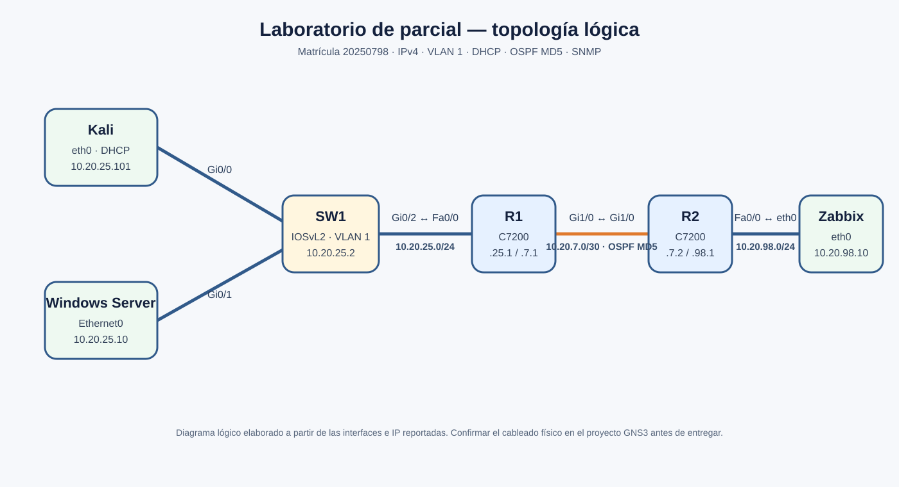

El diagrama es lógico. La captura original de GNS3 disponible durante la práctica mostraba un nodo hub antes de que se documentara el switch IOSvL2; por eso no se presenta como fotografía de la topología final.

## Documentación técnica

La explicación de direccionamiento, conexiones, verificaciones, resultados observados y pendientes está en [documentacion/tecnica.md](documentacion/tecnica.md).

## Evidencias

### OSPF y rutas

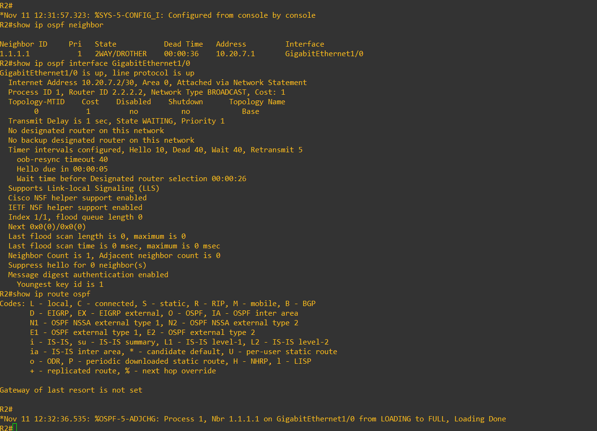

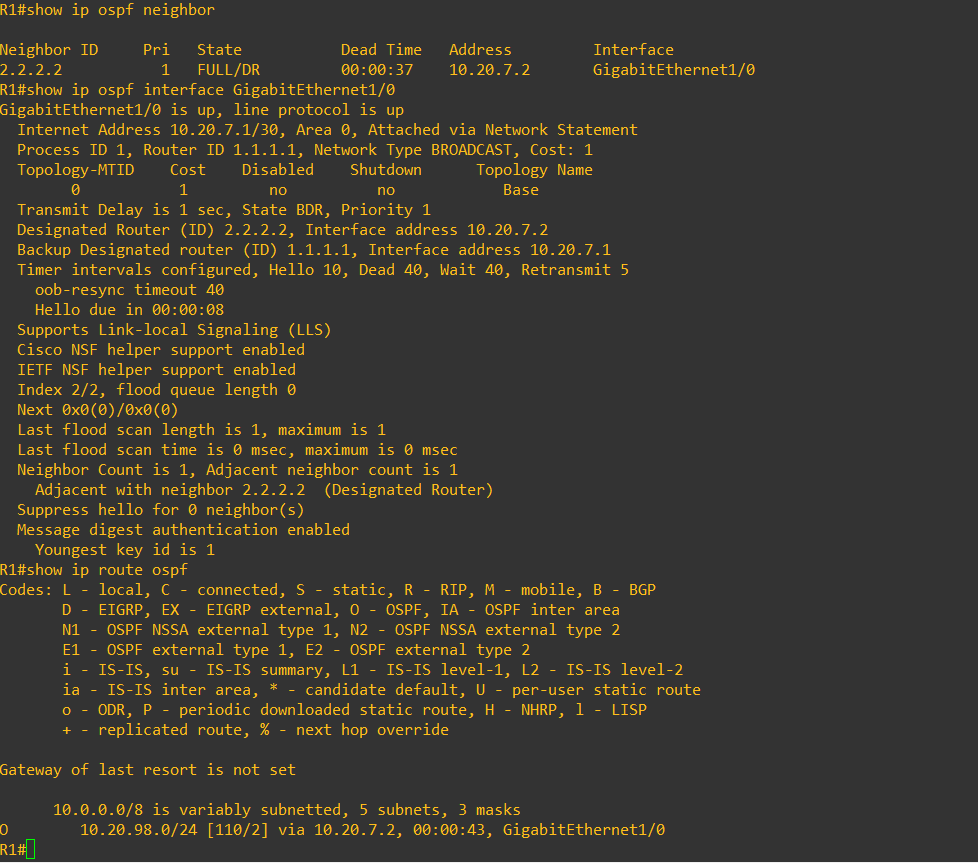

### Switch, DHCP y conectividad

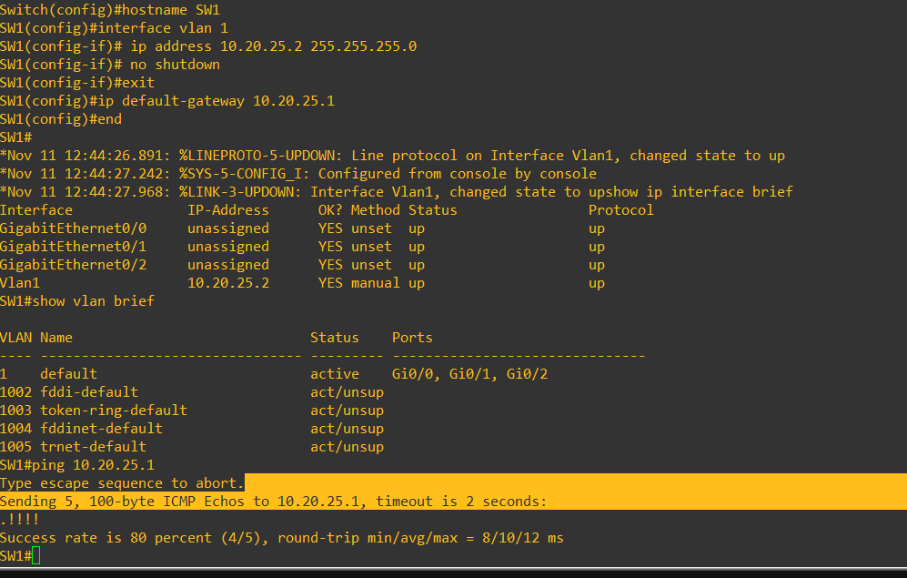

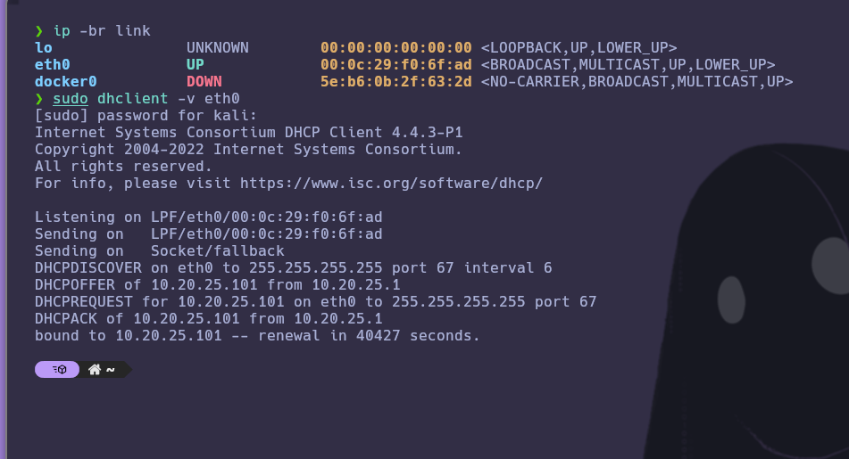

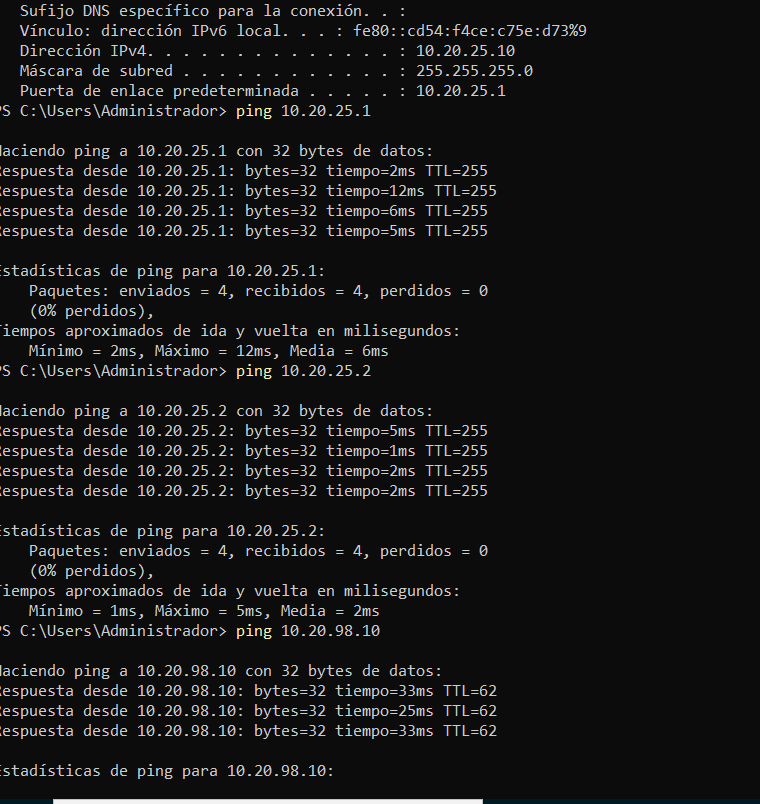

### Administración por SSH y AAA

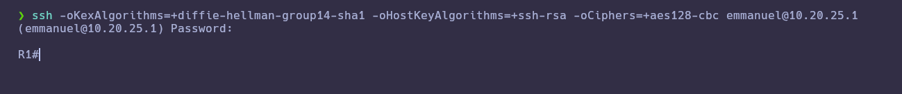

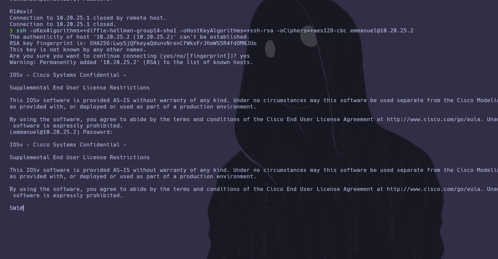

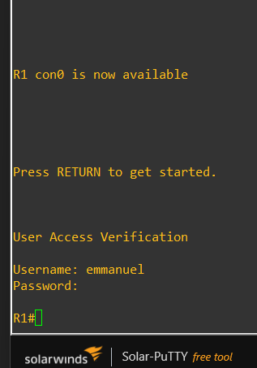

### Zabbix y auditoría de hardening

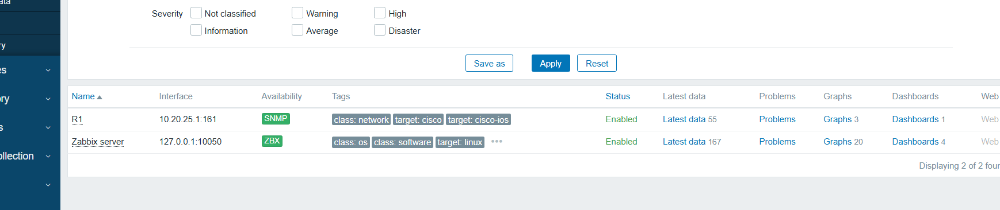

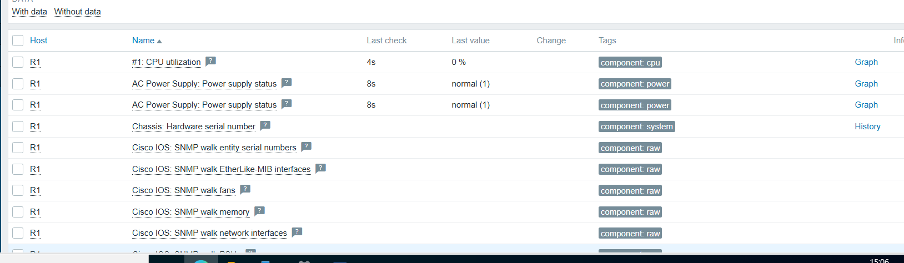

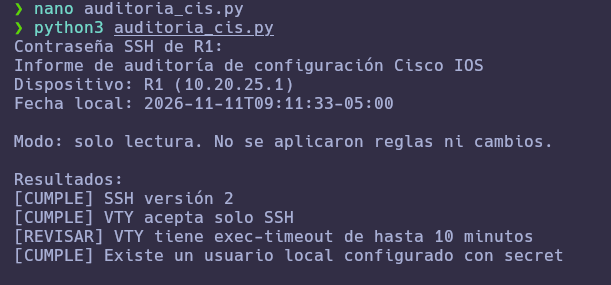

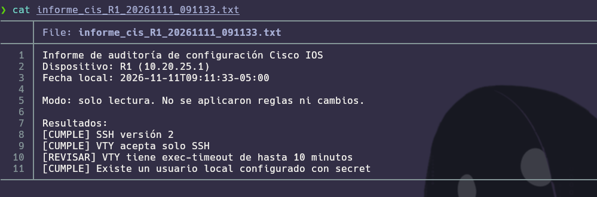

## Archivos

- `configs/`: extractos de configuración recopilados de la práctica. No son exportaciones completas de `show running-config`; véase la nota en la documentación técnica.
- `scripts/auditoria_cis.py`: auditoría de solo lectura de cuatro controles seleccionados.
- `informes/`: informe producido durante la ejecución evidenciada.
- `imagenes/`: capturas de evidencias.
- `diagramas/`: diagramas de topología en formato de imagen.

## Estado antes de entregar

Este paquete organiza las evidencias observadas, pero todavía requiere incorporar las exportaciones completas y actuales de configuración de R1, R2 y SW1, y el enlace real del video de YouTube. La prueba del puerto AUX no se realizó. No presentar este paquete como entrega final hasta resolver esos puntos y revisar el formato solicitado por el profesor.
