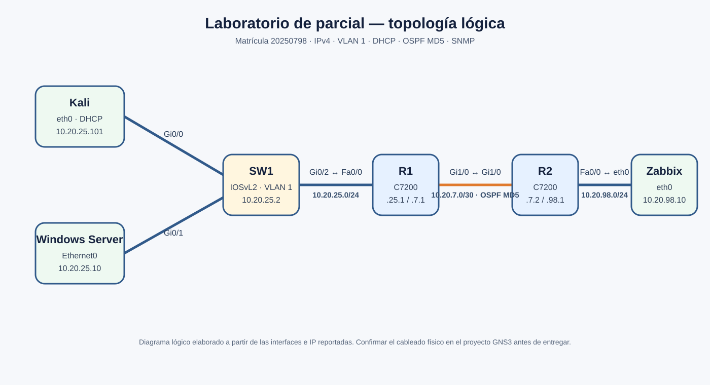

# Documentación técnica

## 1. Alcance

Laboratorio GNS3 construido con dos routers Cisco C7200, un switch Cisco IOSvL2, Kali Linux como estación de prueba, Windows Server 2022 y Zabbix Appliance 7.0.32. La práctica cubre solo los requisitos indicados para el parcial.

## 2. Diagrama y enlaces

| Enlace | Interfaz A | Interfaz B | Red |
|---|---|---|---|
| Kali–SW1 | Kali `eth0` | SW1 `Gi0/0` | VLAN 1, `10.20.25.0/24` |
| Windows Server–SW1 | Windows `Ethernet0` | SW1 `Gi0/1` | VLAN 1, `10.20.25.0/24` |
| SW1–R1 | SW1 `Gi0/2` | R1 `FastEthernet0/0` | VLAN 1, `10.20.25.0/24` |
| R1–R2 | R1 `GigabitEthernet1/0` | R2 `GigabitEthernet1/0` | `10.20.7.0/30` |
| R2–Zabbix | R2 `FastEthernet0/0` | Zabbix `eth0` | `10.20.98.0/24` |

Las interfaces exactas deben cotejarse con el proyecto GNS3 final antes de presentar. En IOS, los nombres pueden aparecer abreviados como `Fa0/0` y `Gi1/0`.

## 3. Direccionamiento

| Equipo | Interfaz | IPv4 | Máscara | Gateway | VLAN |
|---|---|---:|---:|---:|---:|
| R1 | Fa0/0 | 10.20.25.1 | 255.255.255.0 | — | 1 |
| SW1 | VLAN 1 | 10.20.25.2 | 255.255.255.0 | 10.20.25.1 | 1 |
| Windows Server 2022 | Ethernet0 | 10.20.25.10 | 255.255.255.0 | 10.20.25.1 | 1 |
| Kali | eth0 | 10.20.25.101 por DHCP | 255.255.255.0 | 10.20.25.1 | 1 |
| R1 | Gi1/0 | 10.20.7.1 | 255.255.255.252 | — | — |
| R2 | Gi1/0 | 10.20.7.2 | 255.255.255.252 | — | — |
| R2 | Fa0/0 | 10.20.98.1 | 255.255.255.0 | — | — |
| Zabbix | eth0 | 10.20.98.10 | 255.255.255.0 | 10.20.98.1 | — |

Las redes `10.20.25.0/24`, `10.20.7.0/30` y `10.20.98.0/24` son distintas y no se traslapan. El direccionamiento se formó usando los pares de la matrícula `20-25-07-98`.

## 4. Configuración y verificación por requisito

### 4.1 Direccionamiento y conectividad

R1 enruta la LAN de usuarios; R2 conecta la red de Zabbix. Windows Server se dejó con dirección fija y Kali obtiene su dirección por DHCP. Las capturas muestran ping desde SW1 a R1, desde Windows hacia R1, SW1 y Zabbix, y desde el appliance hacia las redes enrutadas.

Comandos de consulta usados: `show ip interface brief`, `ip address`, `ip route` y `ping`.

### 4.2 OSPF con autenticación message-digest

R1 y R2 formaron vecindad OSPF FULL sobre `10.20.7.0/30`. El identificador de R1 es `1.1.1.1` y el de R2 `2.2.2.2`. En las capturas se observan rutas OSPF a `10.20.25.0/24` y `10.20.98.0/24`.

IOS message-digest autentica los paquetes OSPF con MD5; no cifra el contenido completo de los anuncios. Verificaciones: `show ip ospf neighbor`, `show ip ospf interface GigabitEthernet1/0` y `show ip route ospf`.

### 4.3 AAA

La lista `AAA_LOCAL` y autorización EXEC se asignaron a consola y AUX. Se evidenció autenticación por consola. La lista con nombre `AAA_LOCAL` se retiró de VTY para que no apareciera asignada allí: la autenticación SSH se probó por separado.

### 4.4 DHCP

R1 ejecuta el pool `LAN-USUARIOS` para `10.20.25.0/24`, con gateway `10.20.25.1`. La captura de Kali registra `DHCPOFFER` y `DHCPACK` para `10.20.25.101`, emitidos por R1.

Verificaciones: `show ip dhcp pool LAN-USUARIOS`, `show ip dhcp binding` y `ip address` en Kali.

### 4.5 SSH

Se evidenció entrada SSH a R1 y SW1 con el usuario local `emmanuel`. Ambos usan SSH versión 2 y las líneas VTY aceptan SSH. La versión antigua de IOS requiere algoritmos de compatibilidad desde el cliente OpenSSH del laboratorio; esos parámetros se usaron solo en la invocación SSH.

Verificaciones: `show ip ssh`, `show running-config | section line vty` y una conexión desde Kali.

### 4.6 SNMP y Zabbix

R1 tiene una comunidad SNMP de solo lectura asociada a la ACL 20, que permite al host Zabbix `10.20.98.10`. En Zabbix, R1 aparece disponible por SNMP y en Latest data se muestran comprobaciones recientes, como uso de CPU y estado de la fuente de alimentación.

La captura con la comunidad de SNMP se omitió del paquete para no publicar la credencial. La contraseña de comunidad y la clave OSPF deben permanecer limitadas a este laboratorio.

### 4.7 Script de auditoría

`scripts/auditoria_cis.py` consulta `show running-config` por SSH y genera un informe sin enviar comandos de configuración. Controles escogidos del benchmark CIS Cisco IOS 15 v4.1.1:

| Referencia | Comprobación |
|---|---|
| 2.1.1.2 | SSH versión 2 |
| 1.2.2 | VTY solo acepta SSH |
| 1.2.9 | `exec-timeout` de VTY de hasta 10 minutos |
| 1.4.3 | Usuario local configurado con `secret` |

El resultado evidenciado marca los dos primeros y el cuarto como `CUMPLE`; el tiempo de inactividad VTY queda como `REVISAR`. Esto es un resultado de auditoría, no un error de ejecución. El control de `username secret` del script detecta presencia; no evalúa fortaleza de contraseña ni certifica cumplimiento total del benchmark.

## 5. Configuraciones de dispositivos

Los archivos `configs/R1.cfg`, `configs/R2.cfg` y `configs/SW1.cfg` contienen extractos organizados a partir de comandos y capturas compartidos durante la tutoría. No son una exportación completa del estado actual. Se omitieron contraseñas, hash de usuario, clave compartida OSPF y comunidad SNMP. Antes de entregar, generar una copia actual con `show running-config` en cada equipo, revisar líneas sensibles y sustituir estos extractos por los archivos finales requeridos.

## 6. Evidencias observadas

Las imágenes de `imagenes/` son capturas del laboratorio compartidas durante la práctica. El contenido de una captura demuestra solo los comandos y resultados visibles en ella; no se interpreta como verificación de funciones no mostradas.

## 7. Pendientes de entrega

- Exportar y revisar la configuración final de R1, R2 y SW1.
- Si se exige demostrar AAA también por AUX, realizar esa prueba; está pendiente por decisión del estudiante.
- Publicar en YouTube un video de hasta 10 minutos con fecha y hora visibles, rostro y voz, mostrando solo las verificaciones.
- Añadir el enlace real del video al inicio del README.
- Crear el archivo `.txt` con los enlaces de GitHub y YouTube, usando exactamente el nombre y número de parcial que indique el profesor.
